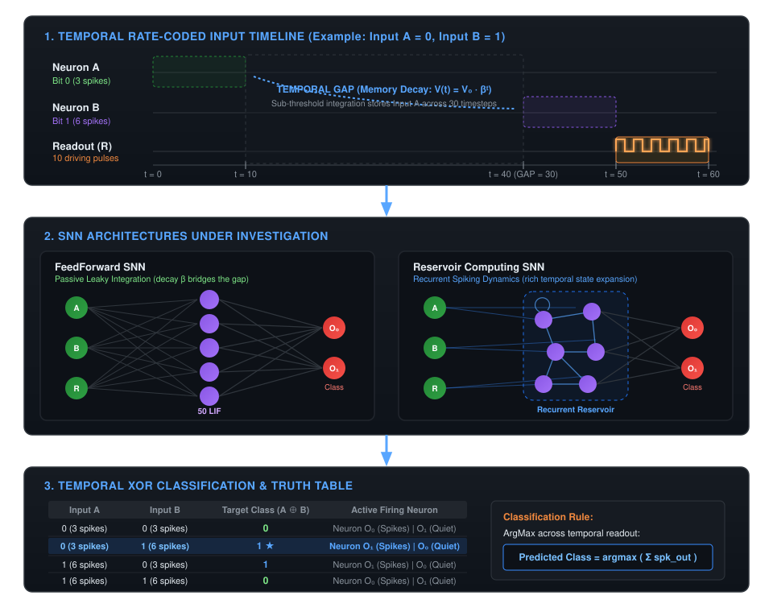
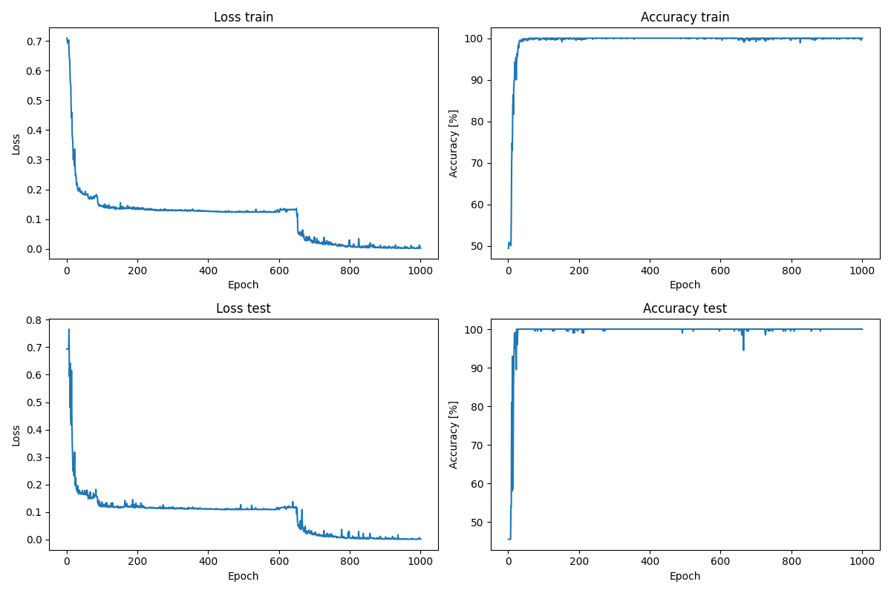

<div align="center">

# ⚡ Temporal XOR with Spiking Neural Networks

[](https://www.python.org/)
[](https://pytorch.org/)
[](https://snntorch.readthedocs.io/)
[](https://optuna.org/)
[](https://wandb.ai/)
[](https://www.polimi.it/)

**Master's Thesis in Engineering Physics — Politecnico di Milano**  
*Investigating temporal integration, sub-threshold memory persistence, and noise robustness in Leaky Integrate-and-Fire (LIF) SNNs.*

---

</div>

## 📌 Project Overview

This repository investigates the computational capabilities and temporal robustness of **Spiking Neural Networks (SNNs)** applied to the **Temporal XOR task**.

In contrast to static XOR, temporal XOR separates the presentation of input signals in time by an arbitrary gap:
* Because FeedForward networks lack recurrent connections, temporal memory relies entirely on the sub-threshold leaky integration of membrane potentials:

$$\tau = -\frac{\Delta t}{\ln \beta}$$

* A terminal **Readout signal** prompts the network to release its integrated state and fire spikes corresponding to $A \oplus B$.

<div align="center">



</div>

---

## 🔬 Key Research & Architectural Features

### 1. ⏱️ Temporal Rate Coding with Gap Noise Injection
* **Rate Coding**: Input bits (0 and 1) are encoded into spike probabilities: $\mathcal{P}_0 = 30\%$ (yielding ~3 spikes over 10 timesteps) and $\mathcal{P}_1 = 60\%$ (yielding ~6 spikes over 10 timesteps).
* **Disturbance Analysis**: Configurable noise spikes can be injected directly into the temporal gap across channels $A$ and $B$.
* **Normalized Center-of-Mass Metric**:

$$\text{Metric}_{\text{noise}} = \frac{\sum t_{\text{gap}}}{N_{\text{spikes}} \cdot \text{GAP}} \in [0, 1]$$

Measures whether noise is concentrated near the start (high decay dissipation) or near the end of the gap (high disruptive impact on signal B).

### 2. 🧠 Leaky Integrate-and-Fire (LIF) Dynamics
* Custom architectures developed using `snnTorch` and `PyTorch`.
* **FeedForward SNNs**: Single and multi-layer architectures exploiting passive membrane integration to bridge temporal delays.
* **Reservoir Computing SNNs**: Recurrent spiking reservoirs for complex non-linear temporal expansion.
* **Fluctuation-Driven Weight Initialization**: Physics-grounded initialization setting synaptic weight variances according to the average input activity and neuron firing thresholds.

### 3. 🎯 Systematic Hyperparameter Optimization
* Optimization driven by **Optuna** with SQLite database persistence (`optuna.study`).
* **Single & Multi-Objective Pareto Optimization**: Trade-off optimization between nominal validation loss and robust validation accuracy under adversarial noise.
* **Curriculum Learning**: Staged training progression from clean baseline, to temporal jitter, to noise injection, up to combined full stress.
* **Frozen Benchmark Validation**: Static balanced validation loaders with isolated PRNG states to eliminate stochastic evaluation drift.
* Exploration of network width, learning rates, schedulers (MultiStepLR, CosineAnnealing), and weight initialization parameters.
* Real-time metrics streaming and loss visualization via **Weights & Biases (W&B)**.
* **Interrupted-Trial Checkpointing**: Robust recovery mechanism saving full PyTorch and Python RNG states, model weights, and optimizer/scheduler states.

### 4. 🛡️ Multi-Dimensional Robustness Framework
* **Seed Variability**: Multiple training runs with independent RNG seeds to assess convergence reliability.
* **Gap Scaling**: Systematic evaluation of memory degradation as the temporal gap is increased across both training and frozen-inference regimes.
* **Noise Sensitivity & 3D Landscapes**: Degradation curves and 3D surface mapping accuracy across temporal gap duration, noise spike counts, and spike arrival timing.
* **Firing Probability Sensitivity**: Rigorous mapping of CMOS-like noise margins across $P_0$ and $P_1$ emission probabilities.
* **Cross-Gap Generalization & Transfer Matrix**: Systematic benchmarking of models trained across different gap lengths (`GAPS_TRAIN`) and evaluated across all test gap lengths (`GAPS_TEST`) with 2D heatmaps.

---

## 📈 Featured Results

Below is a representative training and validation history obtained from an optimized FeedForward LIF model ($H=100, \beta=0.95$, AdamW optimizer with MultiStepLR scheduler):

<div align="center">



*Figure 1: Validation loss minimization and accuracy convergence over 1,000 epochs on the rate-coded Temporal XOR task.*

</div>

---

## 🚀 Quickstart & Usage

### 1. Installation
Clone the repository and install the required dependencies:

```bash
git clone https://github.com/dona/SNNTemporalXOR.git
cd SNNTemporalXOR
pip install torch snntorch optuna wandb matplotlib plotext
```

### 2. Standard Training & Model Inspection
Run the interactive pipeline to train or inspect a trained model:
```bash
python scripts/main.py
```
> [!TIP]
> `main.py` detects whether an optimized model matching `config.py` already exists in `models/`. Trained models are unequivocally tagged as `<model_name>-Clean` or `<model_name>-Noise` with matching `"noise_aware"` JSON metadata.

### 3. Robustness Experiments
Execute seed invariance, gap scaling, and noise sensitivity experiments:
```bash
python scripts/robustness.py
```

### 4. Hyperparameter Search
Launch a config-driven Optuna search sweep (default: `test_2_nominal_50neurons.json`):
```bash
python scripts/optimize_hyperparameters.py --config test_2_nominal_50neurons.json
```

---

## 📂 Repository Structure

```text
SNNTemporalXOR/
├── images/
│   └── Training_FF/                   # Loss and accuracy plots from FeedForward SNN runs
│
├── models/                            # Trained models structured in dedicated folders:
│   └── <model_name>-[Clean|Noise]/   # Directory with weights (.pth) and metadata (.json, noise_aware tag)
│
├── optimization/                      # Config-driven Optuna optimization suite
│   ├── inputs/                        # Study configuration JSON files (search spaces, fixed params)
│   │   ├── test_1_broad_100neurons.json
│   │   ├── test_2_nominal_50neurons.json
│   │   └── test_3_robust_pareto.json
│   └── studies/                       # Isolated environments per experiment
│       ├── test_1_broad_100neurons/   # Historical baseline run (1000 trials, SQLite DB, checkpoints)
│       ├── test_2_nominal_50neurons/  # Mini-HPO 50-neuron run (DB, config snapshot, best models)
│       └── test_3_robust_pareto/      # Multi-Objective Pareto study (DB, curriculum checkpoints)
│
├── robustness_results/                # Test outputs, JSON summaries and figures
│
├── scripts/
│   ├── config.py                      # Global parameters (Single Source of Truth)
│   ├── classes.py                     # SNN architecture and dataset definitions
│   ├── functions.py                   # Data coding, training loops, metrics and plotting
│   ├── main.py                        # Primary training, testing and interactive loading
│   ├── robustness.py                  # Robustness testing suite (seeds, gaps, noise)
│   └── optimize_hyperparameters.py    # Config-driven Optuna & W&B search pipeline
│
└── README.md                          # Project documentation
```

### 📜 Module & Scripts Reference

| Script | Primary Role & Pipeline Description |
| :--- | :--- |
| [`scripts/config.py`](scripts/config.py) | **Central Configuration (Single Source of Truth)**. Holds all global hyperparameters, temporal durations (`SIGN_A`, `SIGN_B`, `GAP`, `READOUT`), rate-coding probabilities, LIF decay factor ($\beta$), and hardware allocation logic. |
| [`scripts/classes.py`](scripts/classes.py) | **Architectural & Data Classes**. Implements `XORSNN` (single hidden layer LIF network with recurrent membrane storage) and `TemporalXORDataset` (deterministic PyTorch dataset generation for rate-coded temporal XOR). |
| [`scripts/functions.py`](scripts/functions.py) | **Core Utility Library**. Handles rate-coded input generation with flexible noise injection, training/evaluation loops, physics-grounded fluctuation-driven weight initialization, dynamic model persistence (`models/`), and ASCII raster plots. |
| [`scripts/main.py`](scripts/main.py) | **Interactive Entrypoint**. Displays active hardware, verifies existing checkpoints to avoid duplicate training, runs forward training or immediate inference, and allows interactive terminal inspection of spike dynamics. |
| [`scripts/robustness.py`](scripts/robustness.py) | **Perturbation & Generalization Suite**. Benchmarks theoretical model stability against external channel disturbances: seed reproducibility, gap duration scaling (training & frozen model), and multi-channel gap noise (Channel A, Channel B, Mixed) with automated CSV/PNG archiving. |
| [`scripts/optimize_hyperparameters.py`](scripts/optimize_hyperparameters.py) | **Bayesian Optimization Engine**. Manages automated distributed hyperparameter search via Optuna (SQLite database) and real-time Weights & Biases (W&B) logging, featuring resilient trial-level checkpointing. |

---

## ⚙️ Configuration Reference (`scripts/config.py`)

All global parameters are managed centrally in [`scripts/config.py`](scripts/config.py):

| Parameter | Default Value | Description |
| :--- | :--- | :--- |
| `SIGN_A`, `SIGN_B` | `10, 10` | Duration (timesteps) of input signals A and B |
| `GAP` | `30` | Number of timesteps separating signal A and signal B |
| `READOUT` | `10` | Timesteps allocated to the terminal readout pulse |
| `PROB_0`, `PROB_1` | `0.3, 0.6` | Spike firing probabilities representing bit 0 and bit 1 |
| `NOISE_SPIKES` | `0` | Default disturbance spikes in gap (`0` for clean training baseline) |
| `NOISE_AWARE` | `False` | Enables noise mixture training and selects/saves `-Noise` models |
| `BETA` | `0.979` | LIF membrane potential decay factor ($\beta = e^{-\Delta t / \tau}$, $\tau \approx 47.9$ timesteps) |
| `INPUT_LAYER`, `HIDDEN_LAYER` | `3, 50` | Network dimensions (Channels A, B, Readout $\to$ Hidden) |
| `FLUCT_XI` | `1.292` | Fluctuation-driven initialization scaling factor |
| `LEARNING_RATE` | `0.00498` | Optimizer base learning rate (AdamW with weight decay $10^{-6}$) |

---

## 💻 Hardware Acceleration

The pipeline dynamically chooses the most efficient execution device based on computed batch workload:

| Platform | Target Device | Notes |
| :--- | :--- | :--- |
| **NVIDIA GPU** | `cuda` | Automatically selected for high batch workloads |
| **Apple Silicon** | `mps` | Enabled when workload exceeds threshold for Metal acceleration |
| **Standard CPU** | `cpu` | Default for lightweight batch sizes to minimize tensor copy overhead |

---

## 🎓 Academic Context

Developed as part of the Master's Thesis curriculum in **Engineering Physics** at **Politecnico di Milano**.  
Supervised research on neuromorphic computing, bio-inspired temporal information processing, and spiking neural dynamics.