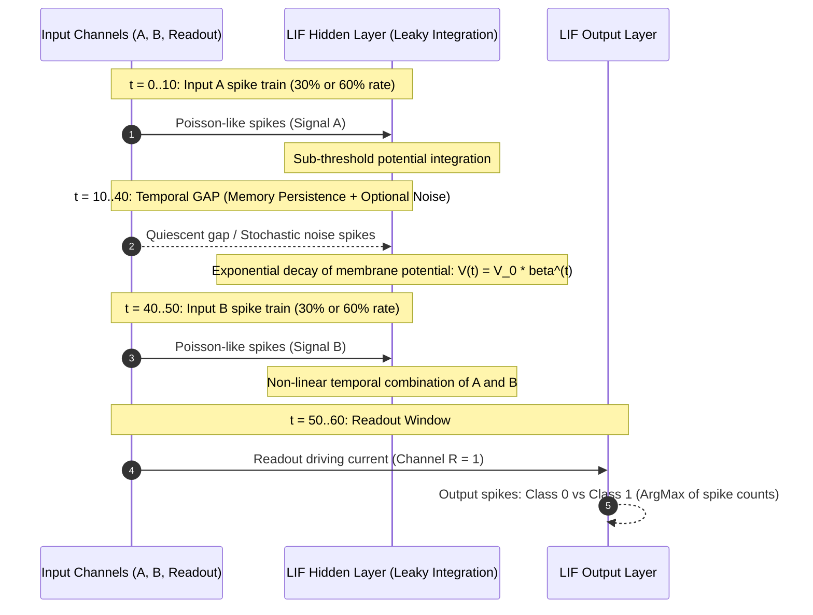

<div align="center">

# ⚡ Temporal XOR with Spiking Neural Networks

[](https://www.python.org/)
[](https://pytorch.org/)
[](https://snntorch.readthedocs.io/)
[](https://optuna.org/)
[](https://wandb.ai/)
[](https://www.polimi.it/)

**Master's Thesis in Engineering Physics — Politecnico di Milano**  
*Investigating temporal integration, sub-threshold memory persistence, and noise robustness in Leaky Integrate-and-Fire (LIF) SNNs.*

---

</div>

## 📌 Project Overview

This repository investigates the computational capabilities and temporal robustness of **Spiking Neural Networks (SNNs)** applied to the **Temporal XOR task**.

In contrast to static XOR, temporal XOR separates the presentation of input signals in time by an arbitrary gap:
* The network receives rate-coded spike trains for inputs **A** and **B** separated by a delay.
* Because FeedForward networks lack recurrent connections, temporal memory relies entirely on the sub-threshold leaky integration of membrane potentials:
  $$\tau = -\frac{\Delta t}{\ln \beta}$$
* A terminal **Readout signal** prompts the network to release its integrated state and fire spikes corresponding to $A \oplus B$.



---

## 🔬 Key Research & Architectural Features

### 1. ⏱️ Temporal Rate Coding with Gap Noise Injection
* Input intensities (0 and 1) are encoded into distinct spike probabilities ($P_0 = 30\%$, $P_1 = 60\%$).
* **Disturbance Analysis**: Configurable noise spikes can be injected directly into the temporal gap across channels $A$ and $B$.
* **Normalized Center-of-Mass Metric**:
  $$\text{Metric}_{\text{noise}} = \frac{\sum t_{\text{gap}}}{N_{\text{spikes}} \cdot \text{Gap}} \in [0, 1]$$
  Measures whether noise is concentrated near the start (high decay dissipation) or near the end of the gap (high disruptive impact on signal B).

### 2. 🧠 Leaky Integrate-and-Fire (LIF) Dynamics
* Custom architectures developed using `snnTorch` and `PyTorch`.
* **FeedForward SNNs**: Single and multi-layer architectures exploiting passive membrane integration to bridge temporal delays.
* **Reservoir Computing SNNs**: Recurrent spiking reservoirs for complex non-linear temporal expansion.
* **Fluctuation-Driven Weight Initialization**: Physics-grounded initialization setting synaptic weight variances according to the average input activity and neuron firing thresholds.

### 3. 🎯 Systematic Hyperparameter Optimization
* Optimization driven by **Optuna** with SQLite database persistence (`optuna.study`).
* Exploration of network width, learning rates, schedulers (MultiStepLR, CosineAnnealing), and weight initialization parameters.
* Real-time metrics streaming and loss visualization via **Weights & Biases (W&B)**.
* **Interrupted-Trial Checkpointing**: Robust recovery mechanism saving RNG states, model weights, and optimizer states every 10 epochs.

### 4. 🛡️ Multi-Dimensional Robustness Framework
* **Seed Variability**: Multiple training runs with independent RNG seeds to assess convergence reliability.
* **Gap Scaling**: Systematic evaluation of memory degradation as the temporal gap is increased across both training and frozen-inference regimes.
* **Noise Sensitivity**: Degradation curves mapping accuracy versus the number and temporal center of mass of gap disturbance spikes.

---

## 📈 Featured Results

Below is a representative training and validation history obtained from an optimized FeedForward LIF model ($H=100, \beta=0.95$, AdamW optimizer with MultiStepLR scheduler):

<div align="center">


*Figure 1: Validation loss minimization and accuracy convergence over 1,000 epochs on the rate-coded Temporal XOR task.*

</div>

---

## 🚀 Quickstart & Usage

### 1. Installation
Clone the repository and install the required dependencies:

```bash
git clone https://github.com/dona/SNNTemporalXOR.git
cd SNNTemporalXOR
pip install torch snntorch optuna wandb matplotlib plotext
```

### 2. Standard Training & Model Inspection
Run the interactive pipeline to train or inspect a trained model:
```bash
python scripts/main.py
```
> [!TIP]
> `main.py` detects whether an optimized model matching `config.py` already exists in `models/`. It allows you to inspect terminal ASCII spike plots or test model robustness interactively.

### 3. Robustness Experiments
Execute seed invariance, gap scaling, and noise sensitivity experiments:
```bash
python scripts/robustness.py
```

### 4. Hyperparameter Search
Launch an automated Optuna search sweep:
```bash
python scripts/optimize_hyperparameters.py
```

---

## 📂 Repository Structure

```text
SNNTemporalXOR/
├── images/
│   └── Training_FF/                   # Loss and accuracy plots from FeedForward SNN runs
│
├── models/                            # Serialized PyTorch model weights (.pth)
│
├── optimization_results/              # Artifacts from Optuna optimization
│   ├── best_models/                   # Models preserved at lowest validation loss
│   ├── checkpoints/                   # Trial checkpoints for resilient recovery
│   ├── archive/                       # Archived historical optimization runs
│   ├── hyperparameter_optimization.db # Persistent SQLite database
│   └── optimization_config.json       # Active search space configuration
│
├── robustness_results/                # Test outputs, JSON summaries and figures
│
├── scripts/
│   ├── config.py                      # Global parameters (Single Source of Truth)
│   ├── classes.py                     # SNN architecture and dataset definitions
│   ├── functions.py                   # Data coding, training loops, metrics and plotting
│   ├── main.py                        # Primary training, testing and interactive loading
│   ├── robustness.py                  # Robustness testing suite (seeds, gaps, noise)
│   └── optimize_hyperparameters.py    # Optuna & W&B search pipeline
│
├── SUGGESTIONS.md                     # Thesis suggestions, mathematical formulas & metrics
└── README.md                          # Project documentation
```

---

## ⚙️ Configuration Reference (`scripts/config.py`)

All global parameters are managed centrally in [`scripts/config.py`](file:///Users/dona/Documents/GitHub/SNNTemporalXOR/scripts/config.py):

| Parameter | Default Value | Description |
| :--- | :--- | :--- |
| `SIGN_A`, `SIGN_B` | `10, 10` | Duration (timesteps) of input signals A and B |
| `GAP` | `30` | Number of timesteps separating signal A and signal B |
| `READOUT` | `10` | Timesteps allocated to the terminal readout pulse |
| `PROB_0`, `PROB_1` | `0.3, 0.6` | Spike firing probabilities representing bit 0 and bit 1 |
| `NOISE_SPIKES` | `3` | Number of disturbance spikes injected into the temporal gap |
| `BETA` | `0.95` | LIF membrane potential decay factor ($\beta = e^{-\Delta t / \tau}$) |
| `INPUT_LAYER`, `HIDDEN_LAYER` | `3, 100` | Network dimensions (Channels A, B, Readout $\to$ Hidden) |
| `FLUCT_XI` | `1.223` | Fluctuation-driven initialization scaling factor |

---

## 💻 Hardware Acceleration

The pipeline dynamically chooses the most efficient execution device based on computed batch workload:

| Platform | Target Device | Notes |
| :--- | :--- | :--- |
| **NVIDIA GPU** | `cuda` | Automatically selected for high batch workloads |
| **Apple Silicon** | `mps` | Enabled when workload exceeds threshold for Metal acceleration |
| **Standard CPU** | `cpu` | Default for lightweight batch sizes to minimize tensor copy overhead |

---

## 🎓 Academic Context

Developed as part of the Master's Thesis curriculum in **Engineering Physics** at **Politecnico di Milano**.  
Supervised research on neuromorphic computing, bio-inspired temporal information processing, and spiking neural dynamics.